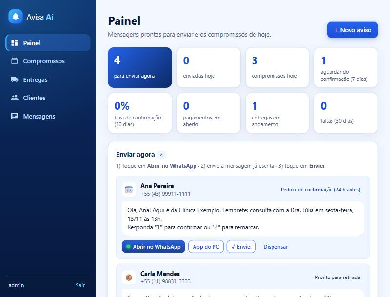
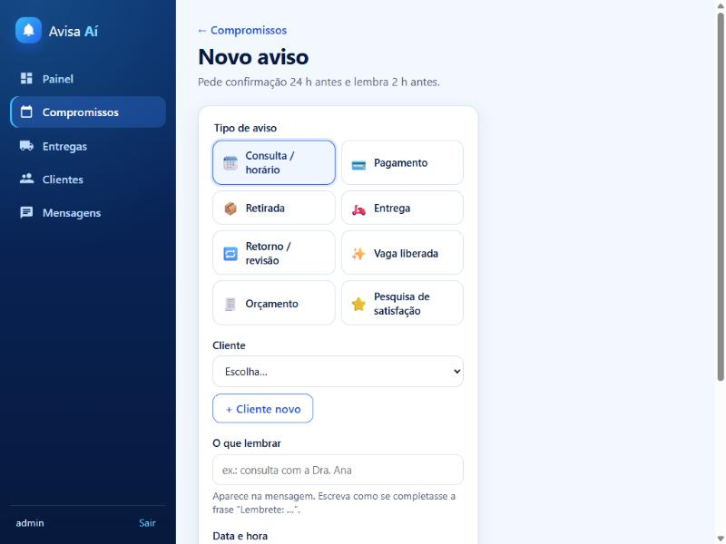
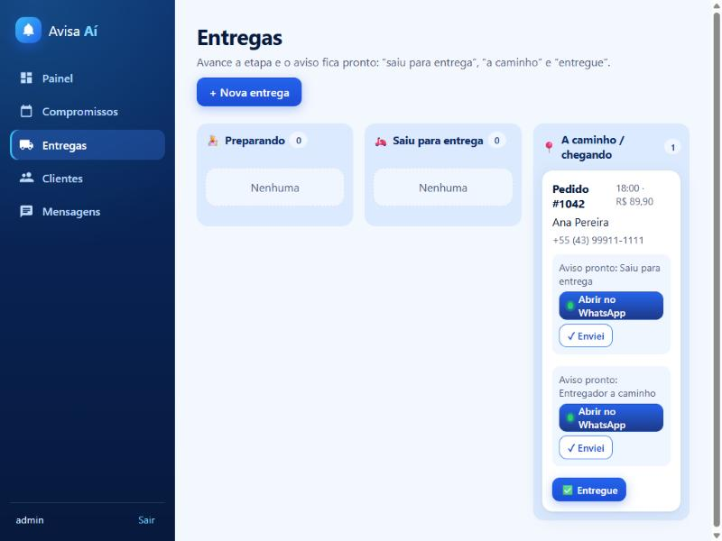
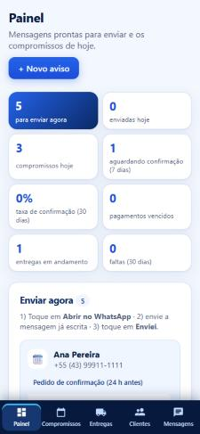

# Avisa Aí — lembretes pelo WhatsApp, sem custo por mensagem

Sistema para pequenos negócios (clínicas, consultórios, oficinas, lojas, entregas) que **prepara as mensagens de WhatsApp na hora certa** — o atendente só toca em *Abrir no WhatsApp* e envia. Funciona no **computador e no celular** (app instalável, PWA).

| Aviso | Quando fica pronto |
|---|---|
| 🗓️ Consulta / horário | pede confirmação 24 h antes ("1 confirma, 2 remarca") e lembra 2 h antes |
| 💳 Pagamento | 3 dias antes, no dia e no dia seguinte ao vencimento (9 h / 10 h) |
| 📦 Retirada (pedido, exame, documento) | quando fica pronto e de novo após 2 dias |
| 🛵 Entrega | "saiu para entrega", "a caminho (chega em X min)", "entregue" — por etapa |
| 🔁 Retorno / revisão | 7 dias antes da data prevista |
| ✨ Vaga liberada (lista de espera) | na hora |
| 🧾 Orçamento | na hora e acompanhamento em 3 dias |
| ⭐ Pesquisa de satisfação (0–10) | 2 h depois do atendimento |

Regras extras: **nada é enviado entre 20 h e 8 h** (o aviso passa para a manhã, ou para a noite anterior se a manhã for tarde demais); cliente **sem consentimento (LGPD) nunca recebe**; aviso de compromisso encerrado/remarcado é cancelado sozinho.



| Novo aviso | Entregas | Celular |
|---|---|---|
|  |  |  |

## Por que é gratuito

A API oficial do WhatsApp Business cobra por mensagem (desde out/2026 inclusive as de atendimento). O Avisa Aí usa o **link oficial "Click to Chat" (`wa.me`)** e o link do WhatsApp Desktop: a mensagem abre pronta no WhatsApp do atendente, que envia com um toque. Sem custo, sem automação não oficial (que viola os termos e pode banir o número). A troca por API paga, se um dia fizer sentido, é um adaptador novo — ver [ADR 0001](docs/adr/0001-whatsapp-por-link-oficial-gratuito.md).

## Pilha

- **Backend:** Java 17, Spring Boot 3.5, Spring Data JPA, Spring Security, H2 (arquivo local) ou PostgreSQL, springdoc-openapi (Swagger UI), ArchUnit.
- **Frontend:** Angular 21 (standalone, zoneless, signals), PWA (service worker), design azul próprio, responsivo (barra lateral no PC, barra inferior no celular).
- **Custo:** zero. Roda no próprio PC; o celular acessa pela rede Wi-Fi.

## Como rodar

```powershell
# 1. App (uma vez, ou depois de mudar o frontend)
cd frontend; npm install; npm run build

# 2. Senha do sistema (opcional; sem ela, uma senha temporária aparece no log)
cd ..\backend; mvn -q test; powershell -ExecutionPolicy Bypass -File scripts\bcrypt-hash.ps1

# 3. Iniciar (app + API no mesmo endereço)
cd ..; powershell -ExecutionPolicy Bypass -File iniciar.ps1
```

Abra **http://localhost:8080** no PC. No celular (mesma rede), abra **http://IP-DO-PC:8080** e use "Adicionar à tela inicial" para instalar.
Desenvolvimento do frontend com recarga automática: `cd frontend; npx ng serve` (o proxy encaminha `/api` para o backend).

## Apresentando o backend

| O quê | Onde |
|---|---|
| Contrato da API, testável no navegador | **Swagger UI:** http://localhost:8080/swagger-ui.html (botão *Authorize* com usuário e senha) |
| Arquitetura em diagramas (modelo C4) | [docs/arquitetura.md](docs/arquitetura.md) |
| Por que cada decisão foi tomada | [docs/adr/](docs/adr) — Architecture Decision Records |
| Regras de arquitetura verificadas a cada build | `backend/src/test/.../ArchitectureTest.java` (ArchUnit) |
| Regras de negócio testadas com datas fixas | `ReminderPolicyTest.java` (anti-falta, horário de silêncio, vencimentos) |
| Roteiro de chamadas pronto para demonstração | [backend/bruno/](backend/bruno) — coleção do Bruno (cliente HTTP gratuito e de código aberto) |
| Saúde do serviço | http://localhost:8080/actuator/health |
| Dados de demonstração | clientes e compromissos fictícios criados no primeiro início (`APP_DEMO_DATA=false` para desligar) |

Mais detalhes e fontes em [docs/apresentar-backend.md](docs/apresentar-backend.md).

## Testes

```powershell
cd backend;  mvn test                    # 19 testes: regras, links, API, arquitetura
cd frontend; npx ng test --watch=false   # testes do app
```

## Licença

MIT.


## Licença

[MIT](LICENSE) — pode usar, modificar e distribuir, mantendo o aviso de direitos autorais.
