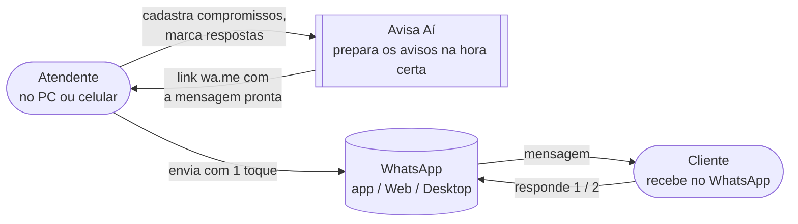
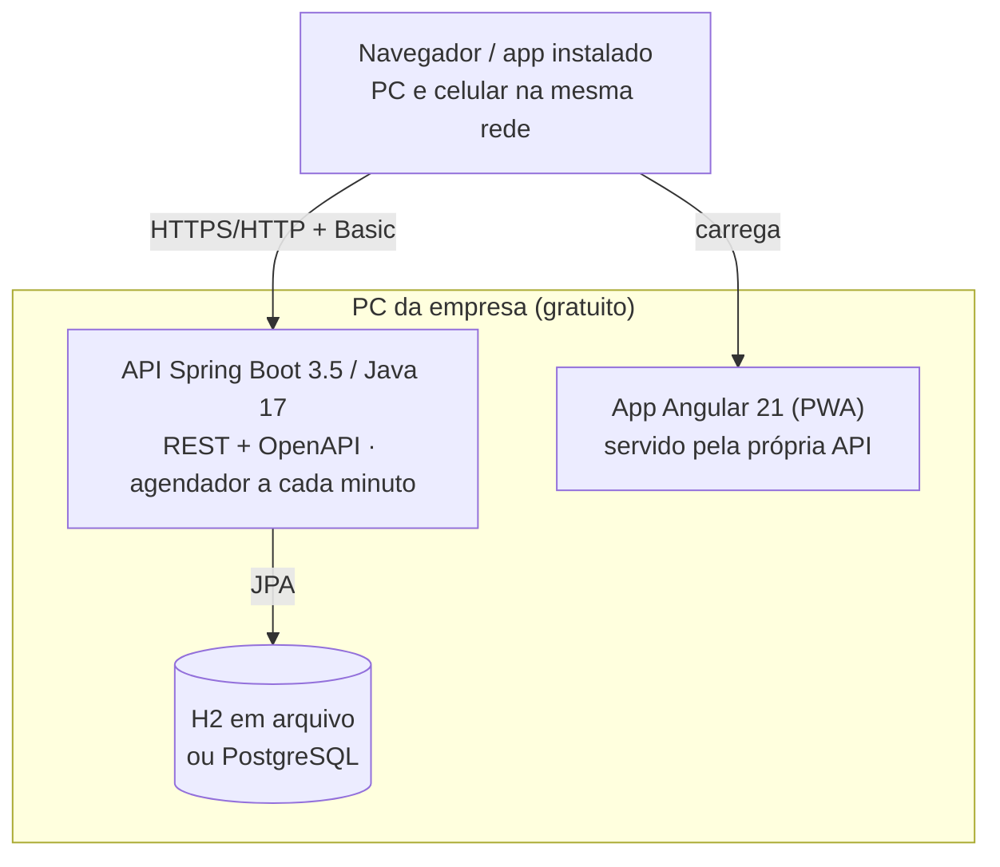
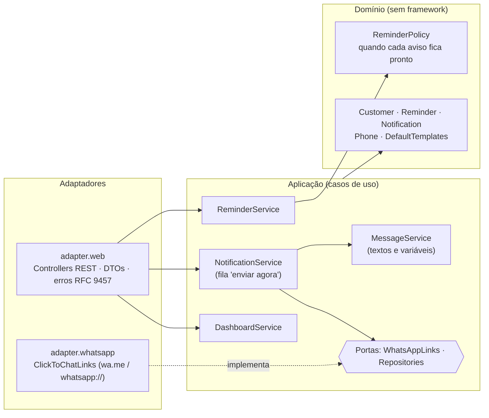
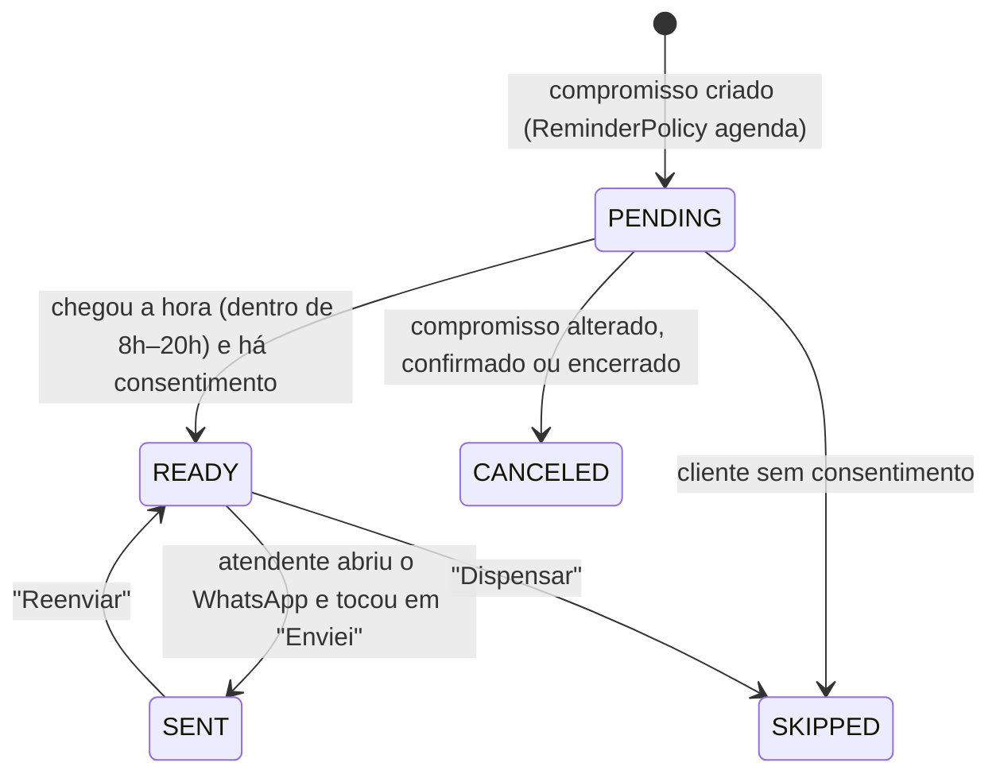

# Arquitetura do Avisa Aí (modelo C4)

O modelo C4 descreve o software em níveis de zoom: contexto → contêineres → componentes. Os diagramas abaixo são Mermaid (o GitHub desenha direto no navegador).

## 1. Contexto

## 2. Contêineres

## 3. Componentes (arquitetura hexagonal)

Regras garantidas por teste (`ArchitectureTest`, ArchUnit): o domínio não depende de Spring nem das camadas externas; a aplicação não conhece os adaptadores; os adaptadores não se chamam entre si.

## Ciclo de uma mensagem

